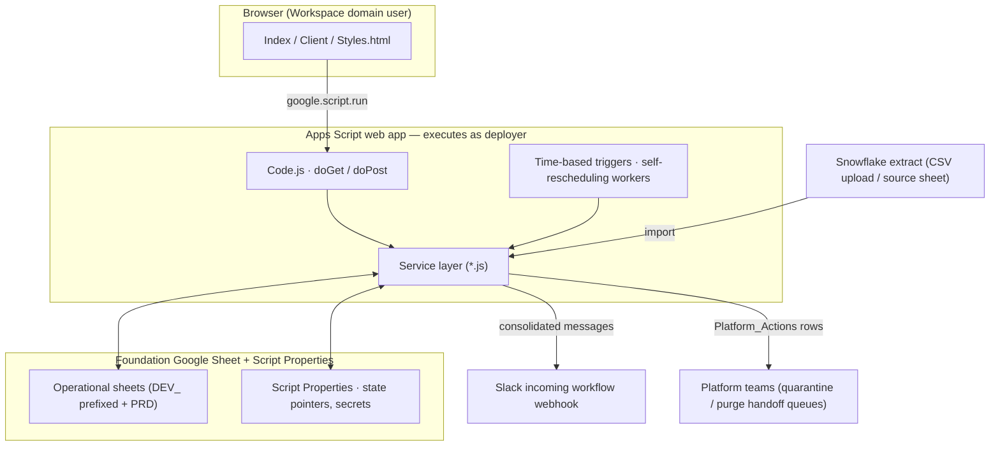
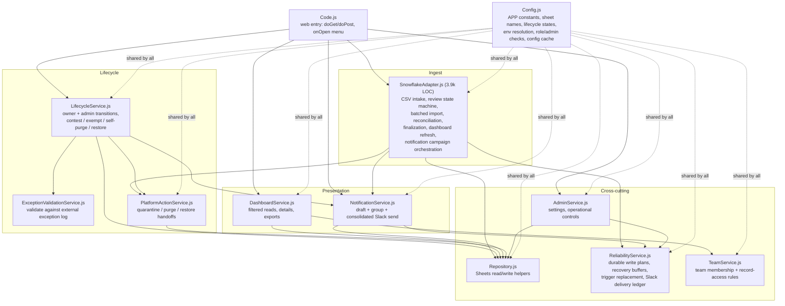
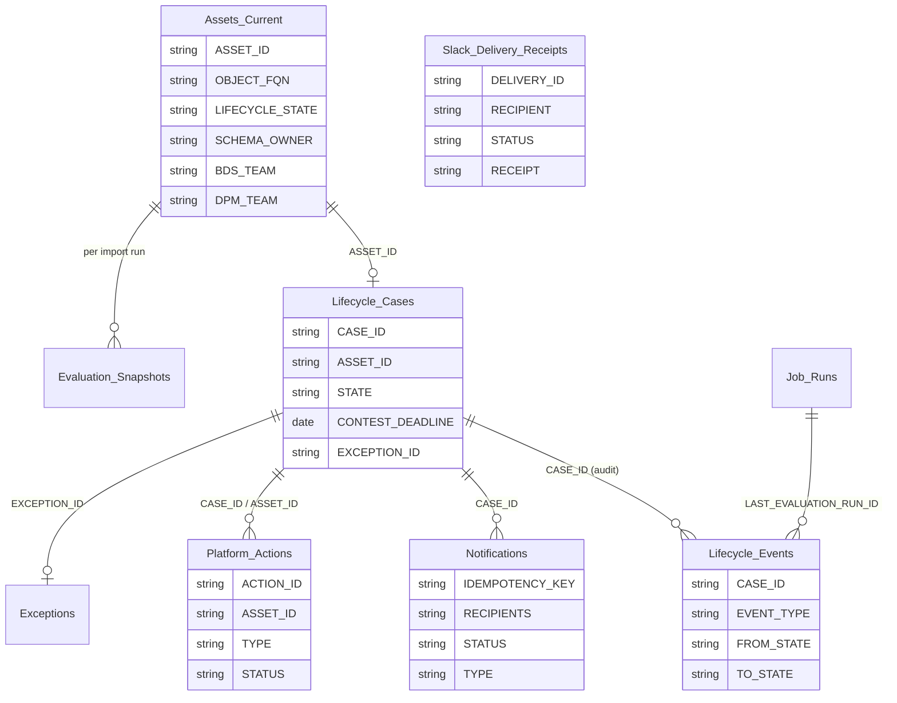
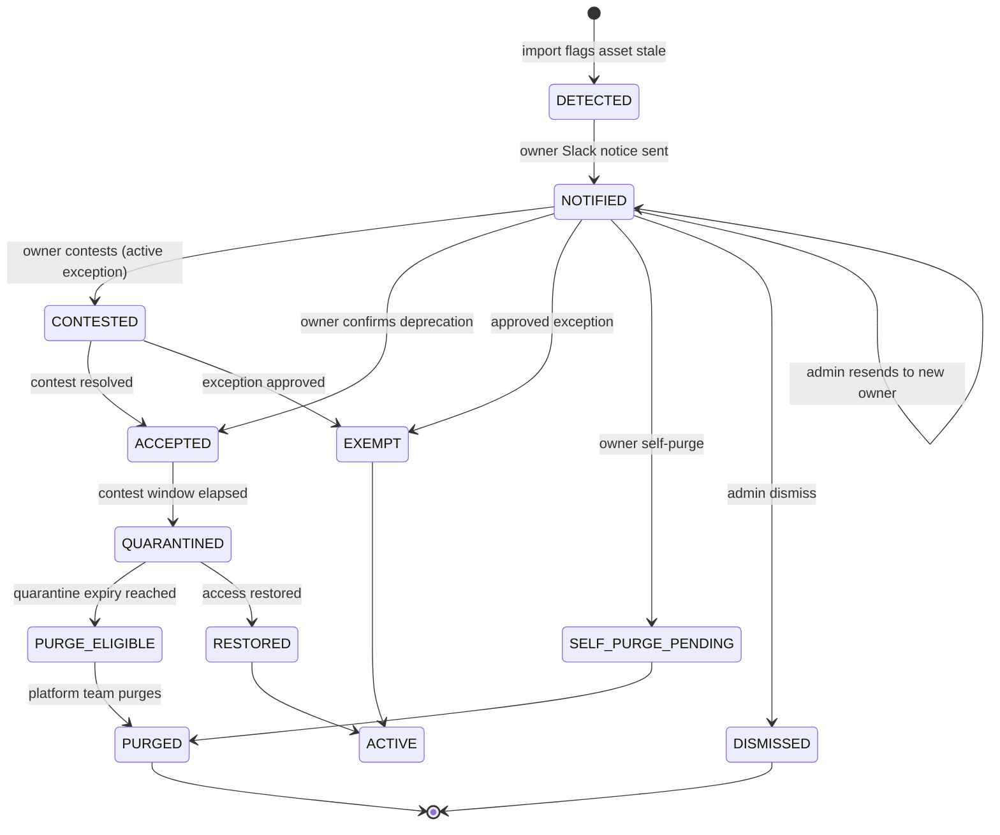
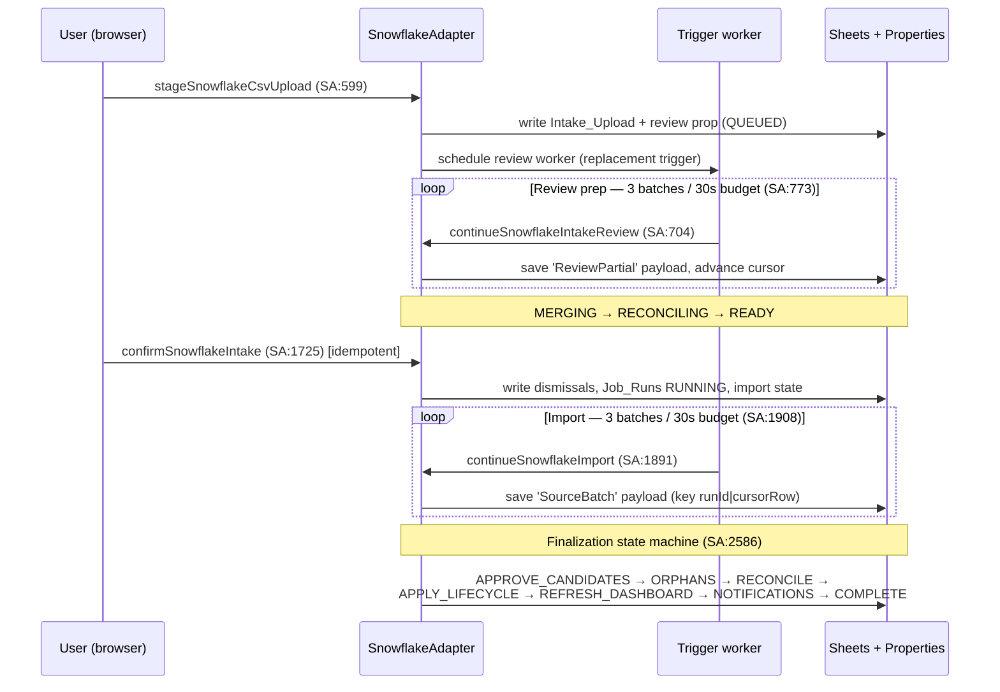
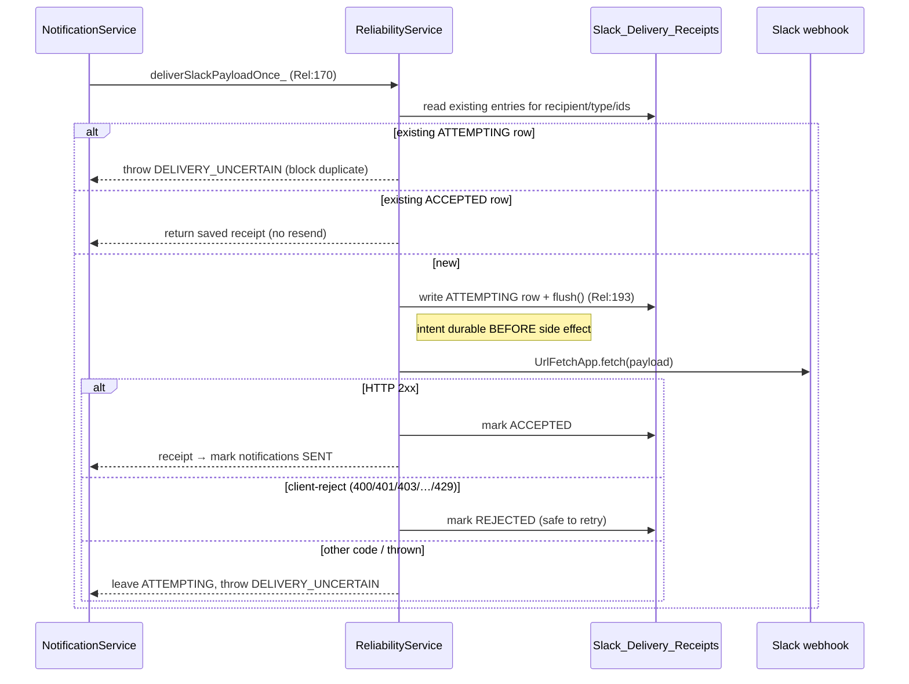

# EDG Stale Data Monitoring — Design Document

> Status: descriptive design derived from the current source (HEAD `4043420`, deployed as web-app version 121).
> Scope: architecture, data model, lifecycle state machine, core flows, and the reliability/recovery design.

---

## 1. Purpose

An internal **Google Apps Script (GAS) web application** that governs the lifecycle of **stale Snowflake data assets**. It ingests periodic Snowflake asset extracts, detects assets that exceed an inactivity threshold, and drives each one through a governed lifecycle — notify owners, allow contest/exception, quarantine, purge, or restore — while:

- restricting record visibility by stewardship / managed team (admins see all),
- delivering **consolidated, de-duplicated Slack notifications** per owner,
- preparing **quarantine / purge handoffs** for downstream platform teams,
- recording every status change, comment, notification, and partner action in an audit history,
- surviving Apps Script's 6-minute execution limit and transient Google/Slack failures via **durable, replayable checkpoints**.

---

## 2. Technology stack & deployment topology

| Concern | Choice |
|---|---|
| Runtime | Apps Script **V8**, `timeZone: America/New_York` |
| UI | Server-rendered `HtmlService` templates (`Index.html`, `Client.html`, `Styles.html`) |
| Persistence | **Google Sheets** (one shared "foundation" workbook) + **Script Properties** for state pointers/secrets |
| Async work | Time-based **triggers** (self-rescheduling workers) |
| Integrations | **Slack** (incoming workflow webhook), optional Snowflake / Data360 action endpoints |
| Auth | Google Workspace domain (`webapp.access: DOMAIN`, `executeAs: USER_DEPLOYING`) |
| OAuth scopes | `spreadsheets`, `script.external_request`, `script.scriptapp`, `userinfo.email` |
| Tooling | `clasp` (script ID pinned in `.clasp.json`), Node-based regression tests |



---

## 3. Component architecture

All server code is a flat set of `.js` files sharing a global scope (GAS convention). Logical layering:



| Module | Responsibility |
|---|---|
| `Code.js` | Web entry (`doGet` renders `Index`, sets deep-link params), `onOpen` sheet menu, `include()` HTML partials. |
| `Config.js` | Frozen `APP` config (spreadsheet IDs, sheet names, lifecycle/asset states, property keys), environment resolution, config cache, **role/admin authorization primitives** (`assertAdmin_`, `assertRole_`, `getUserRole_`). |
| `SnowflakeAdapter.js` | The heavyweight. Owns the entire import pipeline and the notification-campaign orchestrator. |
| `LifecycleService.js` | State transitions: `transitionCase`, owner responses (contest, self-purge, restore, exempt), admin overrides (`adminChangeLifecycleStatus`, `bulkTransitionCandidates`). |
| `ExceptionValidationService.js` | Validates contests/exemptions against the external exception log. |
| `DashboardService.js` | Read-optimized dashboard queries, filtering, per-asset detail, CSV exports. |
| `NotificationService.js` | Builds notification drafts (`Notifications` sheet), groups them per recipient, sends one consolidated Slack message per owner. |
| `PlatformActionService.js` | Non-dispatching quarantine/purge/restore queues (`Platform_Actions`) for downstream platform teams. |
| `TeamService.js` | Team membership + per-record access rules. |
| `AdminService.js` | Admin settings and operational controls (incl. Slack verification entry points). |
| `Repository.js` | Google Sheets persistence helpers (read objects, append, update). |
| `ReliabilityService.js` | Durable write plans, alternating recovery buffers, watchdog/replacement triggers, and the Slack delivery-receipt ledger. |

---

## 4. Environment model

Two environments share **one foundation workbook** (`Config.js:24-27`):

- **DEV** — sheets prefixed `DEV_`; test dataset; imports enabled by default.
- **PRD** — unprefixed sheets; full dataset; **view-only by default** (`READ_ONLY` defaults true for PRD, `Config.js:226`).

**`IMPORT_APPEND_ONLY` (Config sheet, default `FALSE`, accepts `DEV_`/`PRD_` prefix).** Read once when an import starts and stored on the run state as `appendMode`. When `TRUE` the import is for **partial loads**: source batches are appended directly to `Assets_Current` (no staging clear, no buffer swap) and `carryForwardAndReconcileChunk_` is skipped, so existing assets are not compared, carried forward, or purge-verified. Consequences: the file must contain only assets not already in `Assets_Current` (re-uploading an existing FQN creates a duplicate row — nothing dedupes in this mode); assets absent from the file are untouched rather than marked `NOT_PRESENT_IN_LATEST_SOURCE`; `SELF_PURGE_PENDING`/completed-purge cases are not moved to `PURGED` by this run. Dashboard summary is recounted from the whole live sheet instead of this run's counts. The pre-publish review is unchanged and still lists absent assets as "Missing from extract".

**`FINALIZATION_BATCHES_PER_EXECUTION` (Config sheet, default `20`, clamped 1–60, accepts `DEV_`/`PRD_` prefix).** When the finalization phase is in RECONCILE stage, `continueSnowflakeImport` loops up to this many batches per execution while keeping the warm `SHEET_KEY_INDEX_CACHE_` in memory (same pattern as IMPORT phase). Non-RECONCILE finalization stages (APPROVE_CANDIDATES, PREPARE_ORPHAN_HANDOFFS, APPLY_LIFECYCLE, REFRESH_DASHBOARD, NOTIFICATIONS) still run one chunk per execution. Higher values speed up RECONCILE if execution time allows.

**`FINALIZATION_EXECUTION_BUDGET_MS` (Config sheet, default `200000` (ms), clamped ≥30000, accepts `DEV_`/`PRD_` prefix).** Time budget for the RECONCILE batch loop per execution. The loop checks this before starting each batch; execution stops after ~6 min GAS limit is not approached. Measured from the start of the loop in `continueSnowflakeImport` (~line 2090). Increase cautiously; the 6-min limit is hard.

**Known limit:** a RECONCILE batch that carries ≥1 asset forward appends to `Assets_Current`, changing `lastRow`, which auto-invalidates that sheet's cached key index (by design, `Repository.js:63-66`), forcing one rescan of Assets_Current on the next batch. For a complete extract very few assets are carried forward, so most batches hit the cache. If a future import still shows per-batch slowness despite the loop, the cached index can be extended in place after the append instead of rebuilt from scratch.

**Shared** across environments (deliberately): `Config`, `User_Roles`, `ADMINS`, `TEAMS` (`resolveSheetName_`, `Config.js:118-123`). **Environment-specific:** all operational lifecycle sheets.

Non-admin users are always forced to **PRD** (`getActiveEnvironment_`, `Config.js:135`; `getClientConfig`, `:354`). Writes require `assertEnvironmentWritable_` (`Config.js:238-242`), which throws on a read-only environment.

---

## 5. Data model

State lives in **Google Sheets** (durable data) and **Script Properties** (state pointers + secrets). Key sheets (`Config.js:32-50`):



- **`Assets_Current` / `Assets_Staging` / `Assets_Previous`** — the asset table (57 columns, `ASSET_HEADERS`, `Config.js:76-93`). Import writes to `Assets_Staging`, then an atomic-ish rename promotes staging → current (old current → previous).
- **`Lifecycle_Cases`** — one governance case per asset (`CASE_HEADERS`, `Config.js:95-102`): current `STATE`, deadlines, exception linkage.
- **`Lifecycle_Events`** — append-only **audit log** of every transition, comment, notification, and partner action. Event types include:
  - `NOTIFIED` — asset transitioned to NOTIFIED; `DETAILS_JSON` includes recipient info.
  - `CONTESTED` — owner contested; includes exception ID.
  - `ACCEPTED` — owner accepted deprecation.
  - `EXEMPT` — exception approved.
  - `SELF_PURGE_PENDING` — owner requested purge.
  - `QUARANTINED` — asset moved to quarantine.
  - `PURGED` — asset purged by platform team.
  - `RESTORED` — asset restored.
  - `DISMISSED` — admin dismissed case.
  - `OWNERSHIP_CHANGED` — asset ownership (Technical Steward or Schema Owner) changed since last import; only logged for NOTIFIED cases where the resolved primary recipient differs. `DETAILS_JSON` includes `{field, before, after, previousRecipient, newRecipient, previousSource, newSource, changes:[...]}`.
- **`Notifications`** — Slack draft/sent rows, keyed `IDEMPOTENCY_KEY = CASE_ID|TYPE|STATE` (or `CASE_ID|TYPE|STATE|OWNER_CHANGE|<recipient>` for owner-change resends).
- **`Platform_Actions`** — quarantine/purge/restore handoff queue (non-dispatching).
- **`Evaluation_Snapshots`** — per-run evaluation history.
- **`Job_Runs`** — import & campaign job records with counters.
- **`Dashboard_Summary` / `Assets_UI_Index`** — precomputed read-optimized views.
- **`Config`, `User_Roles`, `ADMINS`, `TEAMS`** — shared configuration & access control.
- **`Intake_Upload`, `Intake_Review_Cache`, `Recovery_*`, `Slack_Delivery_Receipts`** — transient/durable-recovery working sheets.

**Script Properties** (`Config.js:18-31`): `SNOWFLAKE_IMPORT_STATE_<env>`, `SNOWFLAKE_INTAKE_REVIEW_<env>`, `IMPORT_NOTIFICATION_CAMPAIGN_<env>`, `ACTIVE_APP_ENVIRONMENT`, plus secrets `SLACK_WORKFLOW_WEBHOOK_URL`, `SNOWFLAKE_ACTION_ENDPOINT`, `DATA360_ACTION_ENDPOINT`, and per-payload `RELIABILITY_<env>_<name>` pointers.

---

## 6. Access control

Three-tier authorization resolved from shared sheets (`Config.js:282-346`):

- **ADMIN** — listed in `ADMINS!EMAILS`; sees all records, both environments, all admin operations.
- **Role users** (e.g. steward) — from `User_Roles`; scoped by team membership.
- **VIEWER** — default; PRD only.

Per-record visibility and "can this user respond to this asset" are enforced by `TeamService.js` + `canUserRespondToAsset_` (`LifecycleService.js:562`). Every mutating entry point calls `assertAdmin_` / `assertRole_` / `assertEnvironmentWritable_` first.

---

## 7. Lifecycle state machine

States are defined in `APP.lifecycle` (`Config.js:51-67`); transitions live in `LifecycleService.js`.



- **Owner actions** (`LifecycleService.js`): `contestAssets` (:373), `requestSelfPurge` (:239), `requestAssetRestorations` (:290), `markAssetsExempt` (:431).
- **Admin actions**: `adminChangeLifecycleStatus` (:110) constrained by `allowedAdminLifecycleTransitions_` (:99); `bulkTransitionCandidates` (:187) for CONFIRM_DEPRECATION / DISMISS. Dismissal is **admin-only** (:74).
  - **Ownership change resend** (`PlatformActionService.js`): `previewOwnerChangeNotifications` (:~715) and `sendOwnerChangeNotificationBatch` (:~750) allow admin to resend `STALE_ASSET_NOTICE` to new Technical Steward or Schema owner if ownership changed on an already-NOTIFIED asset. This is a self-loop (NOTIFIED → NOTIFIED) that does not change lifecycle state but records an `OWNERSHIP_CHANGED` event.
- Transitions that notify go through `transitionCaseAndNotify` (:23) → `immediateNotificationTypeForTransition_` (:44) → the Slack path. Every transition appends a `Lifecycle_Events` audit row via `logEvent_`.
- Timers (`getClientConfig` policy, `Config.js:374-383`): stale threshold 180d, contest window 9d, quarantine 181d, purge notice 30d (all config-overridable).

---

## 8. Core flow — Import pipeline

Entry `stageSnowflakeCsvUpload` → review → confirm → batched import → finalization → dashboard/notifications. Every stage persists a JSON checkpoint to a Script Property, and every mutating write is first saved as a **keyed durable "write plan"** and replayed idempotently on resume.



Key properties of the design:
- **6-minute limit safety**: each worker processes at most ~3 batches and stops after 30s, persisting its cursor and rescheduling itself.
- **Idempotent resume**: batch payloads are keyed by `runId|cursorRow`; a re-run replays the saved payload instead of recomputing (`SA:1963-1965`).
- **Backoff & pause**: caught failures retry the same checkpoint with escalating delay, then pause after 3 attempts for explicit resume (`SA:825-841`, `:1928-1958`).
- **Cell-limit auto-recovery**: `recoverFailedFinalizationState_` (`SA:3850`) rebuilds state from `Assets_Current` if finalization hits Google's 10M-cell limit.

Full stage-by-stage breakdown (functions and line anchors):

| Stage | Entry point | Line |
|---|---|---|
| CSV intake | `stageSnowflakeCsvUpload` | `SnowflakeAdapter.js:599` |
| Review prep (state machine) | `continueSnowflakeIntakeReview` | `:704` |
| Confirm + dismissals | `confirmSnowflakeIntake` | `:1725` |
| Start import | `startSnowflakeImportInternal_` | `:1817` |
| Source batches | `continueSnowflakeImport` → `importSourceChunk_` | `:1891` / `:1961` |
| Finalization machine | `finalizeImport_` | `:2586` |
| Dashboard refresh | `refreshDashboardIndex_` | `:3789` |

---

## 9. Core flow — Slack notifications & delivery recovery

The subtlest part of the system: **guarantee no duplicate Slack sends** even across crashes and ambiguous webhook responses, without receiver-side dedup.



**Admin "Verify uncertain deliveries"** flow (`ReliabilityService.js:217-243`) resolves stuck `ATTEMPTING` rows:
- **RECEIVED** → mark row `ACCEPTED` (`responseCode=MANUALLY_VERIFIED`); next delivery returns the saved receipt and **does not resend**.
- **NOT_RECEIVED** → mark `RETRY_APPROVED`, clearing the block so a retry may send.

Notifications are **grouped one consolidated message per owner** (`NotificationService.js:108-136`, campaign groups `SnowflakeAdapter.js:3129`). Drafts are idempotent via `IDEMPOTENCY_KEY = CASE_ID|TYPE|STATE`. The campaign worker (`continueImportNotificationCampaign`, `SA:2953`) runs `DRAFTING → DELIVERING` under its own time budget, persisting a cursor per batch and self-healing when stalled >5 min (surfaced as the "Run next Slack checkpoint now" banner).

### 9a. Owner-change notification resends

When an asset's Technical Steward or Schema Owner changes and the asset is already in NOTIFIED state (a stale-asset notice was previously sent), the new owner should receive the notice. This is triggered manually by an admin via "Notify new owners" button (Index.html).

**Detection (at import time):**
- `SnowflakeAdapter.js:buildOwnershipChangeEvent_` compares the previous asset against the newly imported one.
- Returns `null` unless:
  - Previous asset exists.
  - Case was NOTIFIED before and remains NOTIFIED after.
  - Ownership field changed (using `normalizedComparisonValue_`).
  - Resolved primary recipient differs (via `resolvePrimaryRecipient_` with `ignoreRecipientLock: true`, allowing DEV to see true owners for comparison).
- If eligible, logs an `OWNERSHIP_CHANGED` event to `Lifecycle_Events` with details (`{field, before, after, previousRecipient, newRecipient, ...}`).

**Admin sweep:**
- `PlatformActionService.js:previewOwnerChangeNotifications` scans `Lifecycle_Events` for `OWNERSHIP_CHANGED` rows and shows a count of eligible assets.
- `PlatformActionService.js:sendOwnerChangeNotificationBatch` collects targets, builds an informed set from existing SENT notifications + owner-change rows already sent, and calls `createAndSendNotificationGroups_` with `{ownerChange: map}` options.
  - For owner-change assets, the idempotency key is `CASE_ID|TYPE|STATE|OWNER_CHANGE|<newRecipient>` instead of the usual `CASE_ID|TYPE|STATE`.
  - This ensures the new recipient receives a distinct notification row, bypassing the standard dedup.
  - The "informed set" rule prevents resending to a recipient if they already received a STALE_ASSET_NOTICE for this asset (via a SENT row) or were already informed by a prior owner-change sweep.

**Message:** Reuses `STALE_ASSET_NOTICE` type; no new Slack catalog entry. The payload is identical to the original stale-asset notice.

---

## 10. Reliability & recovery design (cross-cutting)

`ReliabilityService.js` is the backbone that makes long, mutating workflows crash-safe on GAS:

1. **Write-ahead plans.** `saveDurablePayload_` (:18) records the exact append rows / updates / IDs before applying them; `applyDurableWrites_` (:102) replays idempotently.
2. **Double-buffered recovery sheets.** Payloads land in **alternating** `Recovery_*` slots with a committed pointer property — an interrupted replacement leaves the prior payload readable (`Rel:1-14`).
3. **Watchdog + replacement triggers.** `replaceWorkflowTrigger_` (:129) creates the new trigger **before** deleting the old one, so a worker never loses its wake-up.
4. **Slack delivery ledger.** Intent recorded and flushed before the webhook; ambiguous results held for human verification rather than blindly retried.

> Operational note: the `Recovery_*` and `Slack_Delivery_Receipts` sheets and their associated Script Properties must be preserved — deleting them breaks in-flight recovery.

---

## 11. Security considerations

- **Secrets** (`SLACK_WORKFLOW_WEBHOOK_URL`, action endpoints) live in Script Properties, never in source (`README.md` Security).
- **PRD is view-only by default**; writes require explicit `READ_ONLY=FALSE` config and pass through `assertEnvironmentWritable_`.
- **Recipient locking** (`PRIMARY_RECIPIENT_LOCK`, `ALLOWED_RECIPIENTS`, `Config.js:218-221`) keeps DEV Slack traffic to approved test recipients during live-data testing.
- **`executeAs: USER_DEPLOYING`** with `access: DOMAIN` — the app runs with the deployer's authority for domain users; all mutating entry points re-check role/admin server-side.
- `doGet` sanitizes deep-link params (`asset_id` length + control-char check, env allow-list) and escapes template injection (`Code.js:6-9`).

---

## 12. Deployment

```bash
clasp push --force
clasp version "release description"
clasp deploy -i DEPLOYMENT_ID -V VERSION_NUMBER -d "release description"
```

Update the existing deployment (script ID pinned in `.clasp.json`) rather than creating a new public URL unless a separate environment is intentional. Validate with the Node regression suite (`tests/production-rollout`, `import-performance`, `import-reliability`) and a representative DEV import before promoting.
</content>
</invoke>
